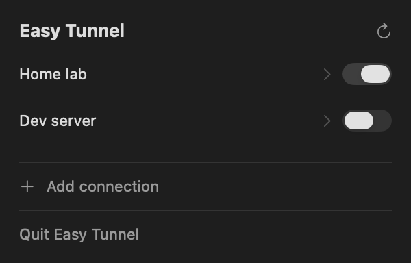
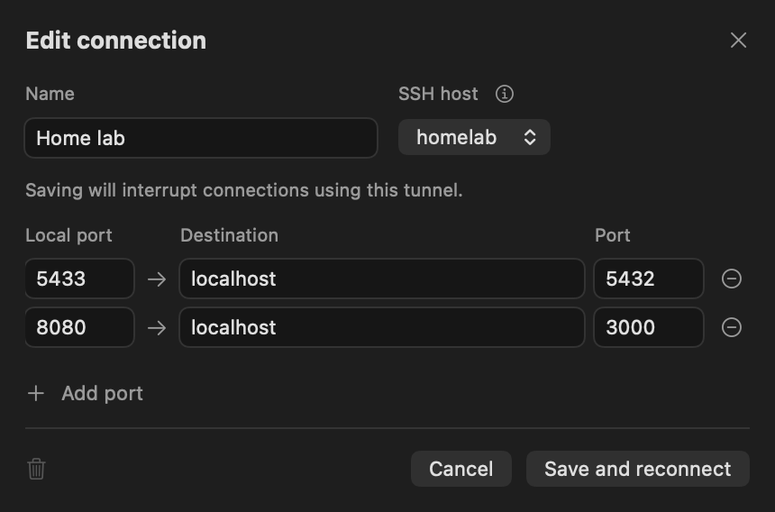

# Easy Tunnel

**Your SSH tunnels, one click away.**

A small, native macOS menu bar app that turns your SSH configuration into saved, reusable tunnels. Choose a host, map your ports, and connect when you need them.

## Why Easy Tunnel?

Accessing a remote database, testing a development service, or reaching your home lab often means rebuilding the same `ssh -L` command and keeping a terminal session around.

Easy Tunnel saves those mappings and puts them in your menu bar. It uses your existing SSH configuration and keys, with no account or backend service to set up.

## Your connections, ready when you need them

Choose a host from `~/.ssh/config`, save multiple port forwards under one connection, and start or stop them with a switch.

Edit active connections with **Save and reconnect**. When something fails, read a short explanation or open the SSH details. The interface uses native macOS controls and follows your system appearance.





## Get started

1. Download the latest Apple Silicon build from [Releases](https://github.com/asnunes/easy-tunnel/releases/latest).
2. Unzip it, move **Easy Tunnel.app** to Applications, and open it.
3. Click its menu bar icon, select **Add connection**, and configure your ports.
4. Save and turn on the connection.

Requires **macOS 13 or later**. Published builds are ad-hoc signed and not notarized.

### Configure an SSH host

Easy Tunnel reads named hosts from `~/.ssh/config`, including entries from `Include` files:

```sshconfig
Host home-lab
    HostName 192.168.1.50
    User alex
    IdentityFile ~/.ssh/id_ed25519
```

Test the connection in Terminal first:

```sh
ssh home-lab
```

Accept the server’s host key there. If your key has a passphrase, load it into your SSH agent. After changing hosts, refresh the host list in Easy Tunnel.

## How tunneling works

Suppose PostgreSQL is running on your remote server. Add this mapping:

| Local port | Destination | Port |
|---|---|---|
| `5433` | `localhost` | `5432` |

Point your database client at `127.0.0.1:5433`. While connected, SSH carries that traffic to port `5432` on the remote server.

**Destination is relative to the SSH server:** `localhost` means the remote server, not your Mac. You can add more mappings to the same connection; they run together in one SSH process.

## What to expect

Closing the panel keeps tunnels running. Quitting stops them. Connections start when you turn them on, with no automatic startup or reconnection. **Save and reconnect** briefly interrupts the selected connection to apply changes.

Local ports bind to `127.0.0.1`. Authentication uses macOS OpenSSH and your existing keys; Easy Tunnel does not store or prompt for passwords or private keys. Your SSH settings, including jump hosts and existing forwarding directives, still apply.

Saved connection names and port mappings stay on your Mac:

```text
~/Library/Application Support/dev.easytunnel.desktop/connections.json
```

## Build from source

Requires Xcode Command Line Tools with Swift.

```sh
git clone https://github.com/asnunes/easy-tunnel.git
cd easy-tunnel
native/build.sh
open "target/release/bundle/macos/Easy Tunnel.app"
```

Written entirely in Swift, using SwiftUI, AppKit, and the system OpenSSH executable. No third-party runtime dependencies.
